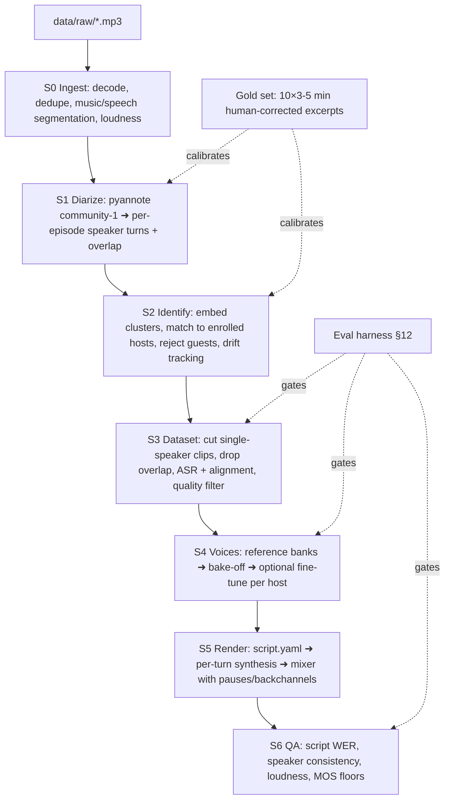

# PodcastSim — Implementation Brief for Claude Code

**Version:** 1.0 (2026-09-02)
**Audience:** a Claude Code instance that will build this system largely unsupervised.
**Status of this document:** research-backed plan. Every model/version/licence claim was checked against primary sources in the first week of September 2026; where a fact could not be verified it is marked *(unverified)*. Treat all numeric thresholds as **starting points to be calibrated on our own data** (see §12.3), not as truths.

---

## 0. How to use this document

You (Claude Code) are building a pipeline that turns a directory of podcast MP3s into three cloned host voices and then renders scripted "fake episodes" in which those voices converse. The work is split into **stages** (§5–§11). Each stage has:

- **Goal** and **inputs/outputs** (file contracts, so stages can be developed and tested independently).
- **Plan A / Plan B / Plan C** — ordered approaches. Always implement Plan A first. Move to Plan B only when Plan A **fails its gate** after reasonable debugging (rule of thumb: two focused attempts or ~2 hours of wall-clock effort, whichever is first). Never skip to Plan B because it looks more interesting.
- **Gate** — an automated test with a pass threshold and an escalate threshold. Gates are designed to run with **no human listening**. A gate result between pass and escalate means "acceptable, log a warning, continue".
- **Anticipated failure modes** — what usually goes wrong and how to recognise it from the metrics.

Rules of engagement:

1. **Log every decision.** Append to `a decision log` (date, stage, what was tried, gate numbers, decision). the owner reads this, not your terminal.
2. **Never delete source MP3s or filtered datasets.** Everything derived is regenerable; sources are not.
3. **Idempotent, resumable stages.** Each stage writes a per-episode manifest (`_DONE.json`) with an input hash, parameter hash, package versions and metrics. Re-running skips completed work unless the parameter hash changed. This is non-negotiable because the compute environment (Colab) is ephemeral (§2).
4. **Fixtures before full runs.** Every stage must first run end-to-end on the `fixtures/` set (≈5 episodes, ≈3 h audio) in under 30 minutes GPU time before touching the 200+ hour archive.
5. **One virtual environment per tool family** (§2.6). The audio ML ecosystem has incompatible pins; do not fight them.
6. **Ask the owner only when blocked by a decision that is truly his** (§16). Otherwise make a reasonable choice, record it in `a decision log`, and proceed.
7. **Ethics/consent** (§15) are hard constraints, not suggestions.

Terminology: **host** = one of the three recurring presenters; **guest** = anyone else; **turn** = a contiguous span of one speaker; **clip** = a 1–20 s single-speaker training segment; **episode** = one source MP3; **gold set** = human-corrected labels used to calibrate gates.

---

## 1. Goal, non-goals, constraints

### 1.1 Goal

Given `data/raw/*.mp3` (200+ hours, English, three recurring hosts, occasional guests, years of recordings), produce:

1. `data/hosts/{host_id}/` — a clean, transcribed, quality-filtered speech dataset per host.
2. `models/voices/{host_id}/` — a voice model (reference bank and/or fine-tuned adapter) per host.
3. `podcastsim render script.yaml → out/episode.wav` — a command that turns a multi-speaker script into a finished episode where the three cloned hosts converse naturally (pauses, backchannels, laughter where scripted).
4. An automated evaluation harness that reports how good each of the above is, without a human listening.

### 1.2 Non-goals (for v1)

- Cloning guests. Guests are detected and **excluded**.
- Real-time / streaming synthesis.
- True overlapping speech in the generated output (no open model does this; we simulate light overlap in the mixer).
- A GUI. CLI + YAML scripts only.
- Music, ads, jingles in generated episodes (can be added later as a mixing step).

### 1.3 Constraints the owner has set

| Constraint | Value | Consequence |
|---|---|---|
| Compute | "Ideally something like Google Colab" | Ephemeral runtimes, session/credit limits, Drive for persistence. See §2. Plan B is a rented persistent GPU box. |
| Data volume | 200+ hours, English | ~3–6 GPU-hours for diarization+ASR on an L4; storage planning matters (§2.5). |
| Licensing | Research / personal use only | Non-commercial models (Fish S2 Pro, F5-TTS, DiariZen, CrisperWhisper, Sortformer v1) are **allowed**. Record licences anyway (§17) in case this changes. |
| Deliverable | Markdown brief for Claude Code | This document. |
| Hosts | Exactly two, known | We can use targeted enrollment rather than blind clustering. |

---

## 2. Infrastructure and execution model

This is the part most likely to derail an autonomous agent, so it is spelled out first.

### 2.1 The problem with Colab for an agent

Colab runtimes are ephemeral (disk wiped on disconnect), have session caps (Pro: background execution but historically ~12 h; Pro+: "up to 24 h" background execution, with user reports of much earlier termination — [colabtools #5950](https://github.com/googlecolab/colabtools/issues/5950)), and GPU choice is best-effort (A100 requests frequently fall back to L4 — [#5342](https://github.com/googlecolab/colabtools/issues/5342), [#6013](https://github.com/googlecolab/colabtools/issues/6013)). Compute is metered in **compute units** (Pro $9.99/mo ≈ 100 CU, Pro+ $49.99/mo ≈ 500 CU, pay-as-you-go $9.99/100 CU). Prices are from third-party summaries *(unverified against Google's sign-in-gated pricing page)*. Approximate burn rates *(unverified, from community reports; check `colab status` / the Colab UI)*: T4 ≈ 1.8 CU/h, L4 ≈ 4.8 CU/h, A100 ≈ 11–13 CU/h. A 500 CU month is therefore roughly 100 L4-hours or 40 A100-hours. That is enough for this project **if** the pipeline is resumable and does not waste re-runs.

### 2.2 Plan A (infra): Claude Code drives Colab via the Colab CLI

Google released an official **Colab CLI** in June 2026 ([repo](https://github.com/googlecolab/google-colab-cli), Apache-2.0; coverage: [MarkTechPost](https://www.marktechpost.com/2026/06/06/googles-new-colab-cli-lets-developers-and-ai-agents-run-python-on-remote-colab-gpus-and-tpus-from-the-terminal/), [Help Net Security](https://www.helpnetsecurity.com/2026/06/08/google-colab-command-line-interface-cli/)). It is explicitly designed for agents (ships an agent skill at `skills/colab-operator/SKILL.md` — read it first), Linux/macOS only. Note: `colab exec` has no `--gpu` flag and takes no positional script arguments (GPU is chosen at `colab new`/`colab run`); pass stage parameters through a config file, or use `colab run --gpu … --keep SCRIPT ARGS`.

```bash
uv tool install google-colab-cli        # or: pip install google-colab-cli
colab auth                              # OAuth2, once
colab new --gpu L4 -s diar              # provision a named session
colab drivemount -s diar                # Google Drive at /content/drive
colab install -s diar -r envs/diarize/requirements.txt
colab upload -s diar src/ /content/podcastsim/src
colab exec -s diar -f scripts/run_stage.py     # reads stage/episode batch from configs/run.yaml (exec takes no script args)
# or, one-shot with args: colab run --gpu L4 --keep scripts/run_stage.py --stage diarize --episodes batch_01.txt
colab download -s diar /content/out/diarize/ out/diarize/
colab log -s diar -o logs/diar_session.md   # format inferred from extension
colab stop -s diar
```

Key properties (from the README): sessions persist across `exec` calls until `colab stop`; a keep-alive daemon prevents idle termination; `colab run --gpu A100 train.py` provisions-and-runs in one step; `upload`/`download`/`drivemount` handle data movement. **Where Claude Code itself runs:** on the owner's laptop, a cheap always-on VM, or the Claude web/Cowork sandbox — anywhere with a terminal and the CLI. The Colab runtime is *only* a GPU worker.

Design rules that follow:

- **State lives on Google Drive** (`/content/drive/MyDrive/podcastsim/`), never on the runtime disk. Every stage reads inputs from Drive and writes outputs + `_DONE.json` to Drive. If the runtime dies, re-running the same command resumes. Drive I/O is slow for many small files, so **shard**: write clips as a few large `.tar` or `.parquet`+FLAC bundles per episode, not 10,000 loose WAVs.
- **Batch by episode.** A stage invocation processes a list of episode IDs; each episode is an atomic unit of work with its own manifest. Choose batch sizes that finish in ≤ 2 hours so that a session death loses little.
- **Bootstrap script** `scripts/colab_bootstrap.sh` recreates the environment on a fresh runtime in < 5 min (uv, pinned wheels cached on Drive under `envs/wheels/`, model weights cached on Drive under `models/cache/` and symlinked into `HF_HOME`). Re-downloading 5 GB of weights every session burns time and quota; cache them once.
- **Watchdog.** `scripts/run_stage.py` wraps each episode in a timeout (1.5× expected), catches CUDA OOM and retries with half batch size, and writes a heartbeat file every 60 s so a supervising Claude Code loop can detect a dead session and re-provision.
- **GPU tier per stage:** T4 (16 GB) is fine for diarization, embeddings, ASR, quality metrics, and zero-shot TTS with ≤2B-parameter models. L4 (24 GB) for fine-tuning and 4–8B TTS models. A100 (40 GB) only for MOSS-TTSD-class 8B dialogue models or if L4 is too slow. Request the cheapest tier that fits; expect A100 requests to be downgraded.

**Gate (infra A):** `scripts/colab_smoke.sh` provisions a T4, mounts Drive, installs the diarize env from cached wheels, runs pyannote on a 60 s fixture, writes a manifest to Drive, tears down — all in < 10 minutes, twice in a row. Also: a deliberately killed session (`colab stop` mid-run) followed by re-run must resume with zero re-processing of completed episodes.

### 2.3 Plan B (infra): a rented persistent GPU box

If the Colab CLI is unavailable to the owner's plan, sessions die faster than batches complete, or Drive I/O makes the pipeline crawl: rent a single persistent pod (RunPod, Vast.ai, Lambda; an L4/A5000/4090-class 24 GB card at roughly $0.3–0.8/h) with a persistent volume and SSH. Claude Code then runs **on** the box (or drives it over SSH), and everything in this document simplifies: no Drive sharding, no session watchdogs, one long-lived set of venvs. Cost for the whole project is likely in the low tens of pounds. **This is the more agent-friendly option; the owner chose Colab for convenience, so try it first, but do not spend more than a day fighting Colab before proposing Plan B in `a decision log` and asking the owner.**

**Gate (infra B):** same smoke test as A, minus provisioning.

### 2.4 Plan C (infra): hybrid

Run CPU-only stages (ffmpeg decoding, dedupe, loudness, manifest bookkeeping, script parsing, mixing) wherever Claude Code lives, and only ship GPU work to Colab. This is also a good optimisation of Plan A.

### 2.5 Storage plan

Rough sizes for 200 h: source MP3s ≈ 12–20 GB; 16 kHz mono FLAC analysis copies ≈ 10–12 GB; per-host filtered clips at 24 kHz FLAC (expect 30–50 % of host speech to survive filtering, i.e. maybe 60–100 h) ≈ 15–30 GB; model caches ≈ 20–40 GB; fine-tune checkpoints ≈ 5–20 GB per model. **Free Drive (15 GB) is insufficient**; assume a 200 GB or 2 TB Google One tier, or keep source MP3s and analysis copies on a local disk and only push clips/models to Drive. Do **not** keep 44.1 kHz WAV copies of the whole archive — decode from the MP3 when cutting clips (§8.2).

### 2.6 Environments (one venv per tool family)

| venv | Contents | Why separate |
|---|---|---|
| `envs/diarize` | `pyannote.audio==4.0.x`, `torchcodec`, matching `torch`, `wespeaker` or `redimnet2`, `silero-vad`, `pyannote.metrics` | pyannote 4 pins torchcodec ↔ torch ABI; needs FFmpeg 4–7 on PATH |
| `envs/asr` | `faster-whisper`, `ctranslate2`, `jiwer`, optional `nemo_toolkit[asr]` for Parakeet, Qwen3-ForcedAligner | NeMo has a heavy, conflicting dependency tree |
| `envs/quality` | `speechmos` (DNSMOS), `utmos`/SpeechMOS, `transformers` (AST tagging), `pyloudnorm`, `torchaudio` SQUIM | onnxruntime pins |
| `envs/tts-<model>` | one per TTS candidate (Qwen3-TTS, Chatterbox, VibeVoice, Fish, MOSS-TTSD…) | every TTS repo pins its own transformers/torch |
| `envs/eval` | `ttsds`, WavLM-SV checkpoint, faster-whisper, speaker models | TTSDS pulls several SSL models |

Use `uv` with an explicit PyTorch index (`--torch-backend=auto` or `[tool.uv.sources]` pointing at `https://download.pytorch.org/whl/cu128` — [uv docs](https://docs.astral.sh/uv/guides/integration/pytorch/)). Commit lockfiles. Record `nvidia-smi`, `torch.__version__`, `torch.version.cuda` into every manifest. Stages communicate only through files, so venvs never need to import each other.

---

## 3. Repository and data layout

```
podcastsim/
  README.md                  # short; points here
  docs/PODCASTSIM_PLAN.md    # this file
  a decision log          # append-only decision log (you write this)
  docs/RUNBOOK.md            # how to run each stage; you write this as you go
  pyproject.toml             # the orchestrator package (CPU-only deps)
  envs/<name>/requirements.txt + uv.lock
  configs/
    pipeline.yaml            # all thresholds live here, never hard-coded
    hosts.yaml               # host_id, display name, enrollment clip list
  src/podcastsim/
    cli.py                   # `podcastsim <stage> --episodes ...`
    manifest.py              # _DONE.json read/write, hashing, skip logic
    stages/
      s0_ingest.py  s1_diarize.py  s2_identify.py  s3_dataset.py
      s4_voices.py  s5_render.py   s6_qa.py
    eval/                    # metrics: der.py sim.py wer.py mos.py prosody.py
    render/                  # script parser, turn synthesis, mixer
  scripts/
    colab_bootstrap.sh  colab_smoke.sh  run_stage.py  make_fixtures.py
  fixtures/                  # ≈5 episodes, gold RTTMs, golden scripts (committed, small)
  tests/                     # pytest; `-m smoke` must pass in <30 min on a T4
  data/            (Drive)   raw/  work/{episode_id}/  hosts/{host_id}/  gold/
  models/          (Drive)   cache/  voices/{host_id}/  finetunes/
  out/             (Drive)   episodes/  eval/
```

**Episode ID:** `sha1(file bytes)[:12]` plus a human slug from the filename. Never key on filenames alone (duplicates and re-uploads are common).

**Manifest contract** (`data/work/{episode_id}/{stage}/_DONE.json`):

```json
{"stage":"s1_diarize","episode_id":"…","input_hash":"…","params_hash":"…",
 "versions":{"pyannote.audio":"4.0.7","torch":"2.x+cu128","gpu":"L4"},
 "started":"…","finished":"…","wall_s":83.2,
 "metrics":{"n_speakers":4,"overlap_ratio":0.041,"speech_ratio":0.87},
 "warnings":[]}
```

**Config contract:** every threshold in this document must be a key in `configs/pipeline.yaml` with the default given here; gates read from config so calibration (§12.3) is a config change, not a code change.

---

## 4. Pipeline overview



Off-the-shelf components chosen (details and alternatives in each stage; registry in §17): ffmpeg, inaSpeechSegmenter, pyannote.audio 4 + `speaker-diarization-community-1`, WeSpeaker ResNet293 / ReDimNet2 embeddings, Silero VAD v6, faster-whisper large-v3 (+ Parakeet-TDT as second opinion), Qwen3-ForcedAligner, DNSMOS/UTMOS/AST filters, Qwen3-TTS / Chatterbox / VibeVoice / Fish S2 Pro / MOSS-TTSD as voice candidates, pyloudnorm, pyannote.metrics, TTSDS2.

Nobody has published a maintained end-to-end repo for exactly this ("archive → link hosts across years → clone → fake episodes"). The closest templates are **Emilia-Pipe** (in-the-wild audio → TTS dataset; [README](https://github.com/open-mmlab/Amphion/blob/main/preprocessors/Emilia/README.md)), **TAGARELA** (8,972 h of podcasts → TTS/ASR data with overlap removal; [repo](https://github.com/freds0/TAGARELA)), **NeMo Curator's audio stages** ([docs](https://docs.nvidia.com/nemo/curator/curate-audio/index.html)), and the prototype **TrashGPT** (2023; podcast → diarize → name speakers → tortoise clones; [repo](https://github.com/paarthtandon/TrashGPT)). Reuse their stage structure and thresholds; do not depend on their code.

---

## 5. Stage 0 — Ingest and normalise

**Goal:** turn arbitrary MP3s into consistent analysis audio plus episode metadata, and remove non-speech (intro music, ads with music beds) before diarization sees it.

**Inputs:** `data/raw/*.mp3`. **Outputs:** `data/work/{ep}/s0/audio16k.flac` (16 kHz mono), `segments_music.json` (speech/music/noise spans), `meta.json` (duration, sample rate, bitrate, ID3 tags, publish date if derivable), `_DONE.json`.

**Plan A**

1. Decode once with ffmpeg: `ffmpeg -i ep.mp3 -ac 1 -ar 16000 -c:a flac audio16k.flac`. Keep the source MP3 for later high-rate cutting; **never re-seek into the MP3 for clips** — MP3 encoder delay and seek inaccuracy shift timestamps (see §14). Record the native sample rate and estimate real bandwidth (many 128 kbps podcasts are low-passed at ~16 kHz; check spectral rolloff with librosa on a 60 s sample — this decides whether "24 kHz" TTS training clips are honest).
2. Exact/near duplicate episodes: SHA-256 of decoded PCM plus MinHash of the later ASR transcript (S3). Drop duplicates, record in `a decision log`.
3. Speech/music/noise segmentation with **inaSpeechSegmenter** (MIT, CNN; [repo](https://github.com/ina-foss/inaSpeechSegmenter)). Mark `music` and `noise` spans; mark `speech` spans that overlap music as `speech_over_music` (ad beds, intros). Everything except clean `speech` is excluded from training clips later; diarization still runs on the whole file (it needs context), but its output is masked.
4. Publish-date extraction: ID3 `TDRC`/`TYER`, else filename regex, else file mtime. Dates drive drift handling in S2. If no date is derivable, order episodes by filename and flag it.

**Gate S0:** on fixtures, `speech_ratio` between 0.6 and 0.98 for every episode; music spans detected in ≥ 80 % of fixture episodes known to have intros (check by listening once when building fixtures, then it's automatic); zero decode failures; total wall time < 30 s per audio-hour on CPU.

**Plan B (if inaSpeechSegmenter misses music beds):** run pyannote VAD and treat VAD-negative + high spectral flatness as music; or run **demucs** (`htdemucs`) vocals separation only on spans flagged as `speech_over_music` and keep the vocal stem for *diarization input* (not for training). Gate: same as A plus manual spot-check of 5 flagged spans by exporting them as short WAVs into `out/review/` for the owner.

**Anticipated failures:** ffmpeg missing on Colab runtime (install via apt in bootstrap); torchcodec/ffmpeg version mismatch (pin torch+torchcodec pair; pyannote 4 requires FFmpeg 4–7 shared libs — [issue #1979](https://github.com/pyannote/pyannote-audio/issues/1979)); variable bitrate files whose durations are misreported by ID3 (always measure from decoded PCM).

---

## 6. Stage 1 — Speaker diarization

**Goal:** per episode, who speaks when, including overlapped regions, with a per-local-speaker embedding.

**Inputs:** `s0/audio16k.flac`. **Outputs:** `s1/diarization.rttm` (overlap-aware), `s1/exclusive.rttm` (one speaker at a time, for ASR alignment), `s1/overlap.json`, `s1/embeddings.npy` (one centroid per local speaker + per-turn embeddings for turns ≥ 2 s), `_DONE.json`.

### 6.1 Plan A — pyannote.audio 4.0.x + `speaker-diarization-community-1`

Why: permissive (CC-BY-4.0), overlap-aware by design (powerset segmentation), best open pipeline on speaker *counting* (the failure that matters for host/guest separation), runs offline after one gated HF download, returns embeddings. DER on standard sets (no collar, overlap scored): AMI 17.0, DIHARD3 20.2, VoxConverse 11.2 ([model card](https://huggingface.co/pyannote/speaker-diarization-community-1)). Clean studio podcasts are much easier; expect single-digit DER with a 0.25 s collar.

```python
from pyannote.audio import Pipeline
pipe = Pipeline.from_pretrained("models/cache/speaker-diarization-community-1")  # snapshot once with HF token, then load from Drive path
pipe.to(torch.device("cuda"))
out = pipe("audio16k.flac", min_speakers=2, max_speakers=6)   # 4.x always returns embeddings; there is no return_embeddings kwarg
diar = out.speaker_diarization          # overlap-aware Annotation
excl = out.exclusive_speaker_diarization
emb  = out.speaker_embeddings           # (n_local_speakers, dim), ordered like diar.labels(); None with oracle clustering
```

Settings: `min_speakers=2, max_speakers=6` — never `num_speakers=3` (guests) and never fully automatic. The single most consequential knob is the VBx clustering `threshold` (default 0.6 in the pipeline config); tune it on the gold set (§12.2). Speed: pyannote 3.1 measured ~92× real-time on an RTX A6000 (~40 s per audio hour) and ~3× on CPU; community-1 is similar. 200 h ≈ 2–3 GPU-hours on an L4 → budget ≈ 15 CU.

Derive overlap regions as frames where ≥ 2 speakers are active in `diar`; pad by 0.25 s each side. Keep per-turn embeddings only for turns ≥ 2 s with zero overlap (community-1 already excludes overlapped frames when embedding).

Long episodes (> 2 h): pyannote's memory is flat for segmentation but embedding count grows; if a 3 h file OOMs or takes > 20 min, split at silences ≥ 2 s into ≤ 60 min chunks and re-link chunk speakers by embedding cosine (> 0.7 → same local speaker).

**Gate S1-A** (all automated):

| Check | Pass | Escalate |
|---|---|---|
| DER (collar 0.25, overlap scored) vs gold set, `pyannote.metrics` | ≤ 10 % | > 20 % |
| JER vs gold (protects low-time guests) | ≤ 25 % | > 40 % |
| Speakers with > 5 % speaking time per episode | 3 or 4 on ≥ 90 % of episodes | 2 or ≥ 5 on > 25 % of episodes |
| Overlap ratio per episode | 2–10 % | > 15 % (music/noise leaking as a speaker) |
| Wall time | < 3 min per audio-hour on L4 | > 10 min |

### 6.2 Plan B — DiariZen (BUT FIT)

If Plan A's DER is > 20 % or hosts are chronically split/merged after threshold tuning. DiariZen (pruned WavLM-Large + Conformer powerset + VBx; models CC-BY-NC-4.0 — fine for research) beats pyannote 3.1 substantially on hard sets (AMI-SDM 13.9 vs 22.4; [repo](https://github.com/BUTSpeechFIT/DiariZen), [tutorial paper](https://arxiv.org/html/2604.21507v1)). Cost: heavier install (pins an older torch/pyannote lineage — put it in its own venv), no `return_embeddings` convenience (re-embed with the S2 model). Gate: identical to S1-A.

### 6.3 Plan C — ensemble / second opinion

Run NVIDIA **Streaming Sortformer v2.1** (`nvidia/diar_streaming_sortformer_4spk-v2.1`, NVIDIA Open Model License, ≤ 4 speakers, handles hours of audio, overlap-aware; [card](https://huggingface.co/nvidia/diar_streaming_sortformer_4spk-v2.1)) as an independent diarizer. Use it two ways: (a) agreement DER between the two systems per episode — < 10 % accept, > 25 % send the episode to a review queue and exclude it from training data; (b) where they disagree, keep only turns both agree on (intersection) for training clips. The 4-speaker cap makes it unsuitable as primary on multi-guest episodes. Gate: agreement DER distribution reported; fraction of episodes excluded < 10 %.

**Anticipated failures:** a host who laughs, reads ads, or phones in gets split into phantom speakers (fixed in S2 by merging clusters that both match the same host); two similar-sounding hosts merged (raise `min_speakers`, lower VBx threshold, or rely on S2's per-turn re-assignment); gated model download inside Colab (snapshot to Drive once with the HF token, then load from path — keep the token out of the pipeline).

### 6.4 Building the gold set (do this before tuning anything)

Ten excerpts of 3–5 minutes, spread across the years and including at least three guest episodes and two with heavy crosstalk. Bootstrap: run Plan A, export RTTM, import into **Label Studio** with the speaker-segmentation template ([template](https://labelstud.io/templates/speaker_segmentation)) or into Audacity label tracks, and have the owner correct errors (correction is 3–5× faster than labelling from scratch; ~1–2 hours of his time total). Also generate **synthetic mixtures** automatically: concatenate high-confidence single-host clips from S3 with random gaps and 5 % engineered overlaps plus real intro music, with exact RTTM. Synthetic DER is optimistic by a few points but is free and fully unsupervised — use it for regression testing, the human gold set for calibration.

---

## 7. Stage 2 — Host identification across episodes

**Goal:** map each episode's local speakers to `{host_a, host_b, host_c}` or `guest_*`, robustly across years of voice/microphone drift, and never let a guest into a host dataset.

**Inputs:** `s1/*`, `configs/hosts.yaml` (enrollment clips), `s0/meta.json` (date). **Outputs:** `s2/assignment.json` (`local_speaker → host_id | guest_k`, similarity scores, margin), `s2/turns.jsonl` (each turn with global speaker label, overlap flag), updated `models/hosts/{host_id}/centroids.parquet` (per-era centroids), `_DONE.json`.

### 7.1 Plan A — enrollment centroids + per-era drift tracking

1. **Embedding model:** WeSpeaker **ResNet293-LM** (`Wespeaker/wespeaker-voxceleb-resnet293-LM`, weights CC-BY-4.0 / code Apache-2.0, VoxCeleb1-O EER 0.45 %) or **ReDimNet2-B6** (MIT, EER 0.29 %, 12 M params; [repo](https://github.com/PalabraAI/redimnet2), [paper](https://arxiv.org/html/2603.11841v1)). Either is more than adequate for three known voices; ReDimNet2 gives more headroom against similar-sounding guests. Do **not** mix embeddings from different models; do not trust embeddings from turns < 2 s.
2. **Enrollment:** the owner hand-picks 2–5 minutes of clean speech per host from 3–5 episodes spread across the years (the only other human task besides gold labelling). Embed in 3 s windows; keep all window embeddings plus their mean. Store in `models/hosts/{host_id}/enroll.parquet`.
3. **Calibrate the threshold** (§12.3): compute same-host vs cross-host cosine distributions on enrollment windows; set `sim_threshold` at the EER point (typically 0.45–0.65 for ResNet-LM-family models; ECAPA runs lower; these numbers are **not** interchangeable across models). Set `margin = 0.10` initially.
4. **Assign per episode:** for each local speaker, embed its longest clean turns (≥ 3 s, no overlap, up to 60 s total) and average; compute cosine to each host's *era centroid* (below); assign to host H if `sim(H) ≥ sim_threshold` **and** `sim(H) − sim(next best) ≥ margin`; otherwise `guest_k`. Two local speakers both matching H → merge (this is the common "host split into two clusters" case). If after assignment a host has < 5 % of episode speech or a guest has > 40 %, flag the episode for review and exclude from training until cleared.
5. **Drift handling:** maintain per-host **per-era centroids** (era = calendar year, or 30-episode windows if dates are missing). After an episode is accepted, update the host's era centroid with an EMA (α = 0.1). Match against the era centroid closest in date; if none exists yet (first episode of a new year), match against the previous era's centroid with the threshold lowered by 0.05. Recording-chain changes (new mics, remote recording) move embeddings more than ageing does — that is why in-era centroids matter.
6. **Per-turn re-check:** after assignment, embed every turn ≥ 2 s individually and compute cosine to its assigned host centroid; drop turns below `sim_threshold − 0.10` from the training pool (they are usually diarization bleed or backchannels). Report the fraction dropped per episode.

**Gate S2-A:**

| Check | Pass | Escalate |
|---|---|---|
| Host assignment accuracy on gold episodes (local speaker → host label) | 100 % of gold hosts correct, 0 guests labelled as hosts | any guest→host error |
| Per-episode best-match cosine for each host | ≥ `sim_threshold` on ≥ 95 % of episodes | < 0.4 on > 10 % |
| Episodes flagged for review | < 10 % | > 25 % |
| Host speaking time share (sum over archive) | each host 15–60 % | any host < 5 % |
| Silhouette score of turn embeddings by assigned label (cosine) | > 0.3 | < 0.1 |

### 7.2 Plan B — global re-clustering

If per-episode matching drifts or the enrollment set turns out unrepresentative: pool all local-speaker centroids from all episodes (a few thousand vectors), run agglomerative clustering with cosine distance and a threshold ≈ `1 − sim_threshold`, and inspect the largest three clusters — they are the hosts. Recurring guests appear as medium clusters (useful metadata). Map enrollment embeddings to clusters to name them. This is the pattern pyannote maintainers recommend for cross-file speaker linking ([discussions #1085](https://github.com/pyannote/pyannote-audio/discussions/1085), [#1667](https://github.com/pyannote/pyannote-audio/discussions/1667)). Gate: same as A; additionally cluster purity vs gold ≥ 98 %.

### 7.3 Plan C — semi-supervised bootstrapping

If drift is severe (e.g. a host's early-years voice fails to match), iteratively: accept high-confidence episodes → re-enrol from them → re-run neighbours in date order, propagating centroids forward and backward in time. Stop when assignments are stable for two passes. Gate: same as A, plus assignments must not change for > 2 % of episodes between the final two passes.

**Anticipated failures:** guest who shares a mic/room with a host (embedding pulled toward host; the margin rule catches most, the per-turn re-check catches the rest); remote host over a phone codec (band-limited embeddings — treat "phone-in" episodes as their own era or exclude); backchannels assigned to the wrong host (handled by S3 minimum duration and overlap rules).

---

## 8. Stage 3 — Per-host training datasets

**Goal:** clean, transcribed, quality-filtered single-speaker clips per host, in the format the TTS candidates expect (24 kHz mono FLAC/WAV + `metadata.jsonl` with text), plus rich per-clip metadata for reference-bank selection.

**Inputs:** `s2/turns.jsonl`, source MP3, `s0/segments_music.json`. **Outputs:** `data/hosts/{host_id}/clips/{shard}.tar` (or parquet + FLAC), `data/hosts/{host_id}/metadata.jsonl`, `data/hosts/{host_id}/stats.json`, `_DONE.json` per episode.

### 8.1 Plan A (follows Emilia-Pipe / TAGARELA / NeMo Curator conventions)

1. **Candidate turns:** host-assigned turns with zero overlap after 0.25 s padding, not inside music/`speech_over_music` spans, duration ≥ 1.0 s. Discarding overlaps loses ~3–8 % of speech and avoids timbre contamination; **do not** try to separate overlapped speech for training data (separation artefacts get learned).
2. **Cut at native rate:** decode the whole MP3 once to a temp WAV at native rate (44.1/48 kHz), slice by sample index using the 16 kHz timestamps, then resample to 24 kHz (or the target model's rate). Delete the temp WAV. Never feed 16 kHz clips to a 24 kHz TTS.
3. **Re-segment with Silero VAD v6** ([versions](https://github.com/snakers4/silero-vad/wiki/Version-history-and-Available-Models), MIT): trim edges, split long turns at pauses into 3–20 s clips (Emilia: 3–30 s; TAGARELA: 5–20 s), keep 100–200 ms of silence padding.
4. **ASR per clip** with **faster-whisper large-v3** (`beam_size=5, condition_on_previous_text=False, vad_filter=True`, keep `avg_logprob`, `no_speech_prob`, `compression_ratio`). Second opinion with **Parakeet-TDT-0.6B-v3** (CC-BY-4.0, English WER ≈ 6.3, native word timestamps) — drop clips where inter-ASR WER > 15 %. Optional for research: **CrisperWhisper** (CC-BY-NC) keeps "um/uh" verbatim, which matters if you want the clones to *sound* like the hosts' actual disfluent speech.
5. **Word alignment** with **Qwen3-ForcedAligner-0.6B** (Apache-2.0, ~43 ms mean boundary error vs ~130 ms for WhisperX/NFA; [card](https://huggingface.co/Qwen/Qwen3-ForcedAligner-0.6B)). Use the alignment score to reject clips with mean token score < 0.5 or any word gap > 1.5 s. Fallback: WhisperX wav2vec2 alignment.
6. **Quality filters** (per clip; all in `configs/pipeline.yaml`):
   - DNSMOS P.835 `OVRL ≥ 3.0` (Emilia's gate; `speechmos` package), `BAK ≥ 3.5`.
   - UTMOS ≥ 3.5 (NeMo Curator recommends ≥ 4.0 for voice cloning, but podcasts rarely exceed ~4.2 — start at 3.5, inspect the distribution, record what you chose).
   - WADA-SNR ≥ 20 dB (cheap numpy implementation).
   - AST AudioSet tagging (`MIT/ast-finetuned-audioset-10-10-0.4593`): P(Music) < 0.2, P(Laughter) < 0.3 unless the clip is being kept for the laughter bank (§10.3), top-1 = Speech.
   - Speaker purity: cosine to host era centroid ≥ `sim_threshold − 0.10`.
   - Whisper sanity: `avg_logprob > −0.7`, `no_speech_prob < 0.5`, `compression_ratio < 2.4`; language = en with p ≥ 0.8.
   - No clipping (> 0.1 % samples at full scale), no DC offset, duration 1–20 s.
   - Near-duplicate text (MinHash Jaccard > 0.8 on 5-grams — repeated ad reads/intros) → keep one copy, tag the rest `boilerplate`.
7. **Loudness:** `pyloudnorm` to −23 LUFS integrated per clip (or −20 dBFS RMS, Emilia style), true peak ≤ −1 dBTP.
8. **Metadata per clip:** host, episode, date/era, start/end, text (raw and normalised), duration, all metric values, speaking rate (words/s), F0 median/IQR (`praat-parselmouth`), emotion tag (optional: `emotion2vec` or SenseVoice), `has_laughter`, `is_boilerplate`. This metadata is what makes reference-bank selection (§9.2) possible.

**Gate S3-A:**

| Check | Pass | Escalate |
|---|---|---|
| Retained hours per host | ≥ 5 h each (with 200 h source, expect 20–40 h/host) | < 1 h for any host |
| Retention rate of host speech | 30–60 % | < 20 % (filters too strict) or > 85 % (filters not working) |
| Speaker purity: cosine to own host ≥ threshold | ≥ 98 % of clips | < 95 % |
| Cross-host leakage: clips closer to another host's centroid | < 0.5 % | > 2 % |
| DNSMOS OVRL distribution after filtering | mean ≥ 3.2, sd ≤ 0.2 (Emilia: 3.26 ± 0.14) | mean < 3.0 |
| Inter-ASR WER on retained clips | median < 5 % | median > 10 % |
| Duration distribution | median 5–10 s, < 2 % over 20 s | — |
| Transcript sanity | < 1 % clips with empty/one-token text | — |

### 8.2 Plan B — relax or repair

If retention is too low: drop DNSMOS OVRL to 2.7 (Emilia-Large used 2.4) and UTMOS to 3.2, log it; apply **DeepFilterNet3** denoising (MIT/Apache, 48 kHz) *only* to clips in the 2.5–3.0 OVRL band and re-score — never enhance the whole dataset, and never use "enhance/bandwidth-extension" modes (they hallucinate timbre). If purity is poor: tighten S2's per-turn threshold instead of filtering here.

### 8.3 Plan C — separate the music beds

If large amounts of host speech sit under music (heavy ad reads / intros), run **BS-RoFormer** via `python-audio-separator` (MIT package; check each checkpoint's licence) or `demucs htdemucs` on `speech_over_music` spans only, then feed the vocal stem through steps 3–7 with a stricter OVRL ≥ 3.2. Gate: same as A; additionally, separated clips must not exceed 15 % of any host's dataset (tag them so a fine-tune ablation can exclude them).

**Anticipated failures:** whisper hallucinating on trailing silence (VAD trimming + `compression_ratio`); numerals/currency dropped by aligners (normalise text before alignment); Drive being hammered by 50k small files (shard into tars); UTMOS penalising expressive/laughing speech (keep a separate "expressive" pool with lower UTMOS floor for the reference bank, exclude from fine-tuning if it hurts).

---

## 9. Stage 4 — Voice models per host

**Goal:** for each host, the best-sounding, most-similar voice we can get with off-the-shelf models, chosen by an automated bake-off rather than by taste.

**Inputs:** `data/hosts/{host_id}/`. **Outputs:** `models/voices/{host_id}/reference_bank.parquet`, optionally `models/finetunes/{model}/{host_id}/` (adapter or checkpoint), `out/eval/bakeoff_{date}.md` + per-utterance parquet, `configs/voices.yaml` (which engine + settings won per host).

### 9.1 The landscape in one paragraph (Sept 2026)

The 2024-era favourites (XTTS-v2, F5-TTS, GPT-SoVITS) are stale or outclassed on speaker similarity by LLM-style codec TTS. Strong permissive models: **Qwen3-TTS-12Hz-1.7B-Base** (Apache-2.0, Jan 2026; variants `-Base` for zero-shot cloning, `-CustomVoice`, `-VoiceDesign`, plus 0.6B versions; 3 s zero-shot, official fine-tuning, Seed-TTS-eval EN WER 1.24 / SIM 0.775 for 1.7B-Base; [repo](https://github.com/QwenLM/Qwen3-TTS)), **Chatterbox Multilingual v3 / Turbo** (MIT, June 2026, most battle-tested, `[laugh]`-style tags, Perth watermark; [repo](https://github.com/resemble-ai/chatterbox)), **VoxCPM2** (Apache, 48 kHz, LoRA on 5–10 min; [repo](https://github.com/OpenBMB/VoxCPM)), **Zonos2** (Apache, June 2026, new). Native multi-speaker dialogue models: **MOSS-TTSD v1.0** (Apache, 8B, 1–5 speakers, 60 min; [repo](https://github.com/OpenMOSS/MOSS-TTSD)), **VibeVoice-1.5B/7B** (MIT weights but Microsoft's card says research-only and requires recorded consent for impersonation; up to 4 speakers, 90 min; community fork [here](https://github.com/vibevoice-community/VibeVoice), LoRA fine-tuning [here](https://github.com/voicepowered-ai/VibeVoice-finetuning)), **SoulX-Podcast-1.7B** (Apache, explicit laughter/sigh/breath tags; [repo](https://github.com/Soul-AILab/SoulX-Podcast)). Research-only but top quality: **Fish Audio S2 Pro** (Fish Research Licence; highest open-weight Elo on the Artificial Analysis arena ≈ 1123; multi-speaker multi-turn; needs ~24 GB; [card](https://huggingface.co/fishaudio/s2-pro/blob/main/README.md)), **F5-TTS** (CC-BY-NC; small, fast, but single-speaker fine-tunes on 6–12 h gave "minimal improvement" per its own community — [discussion](https://github.com/SWivid/F5-TTS/discussions/57)), **Higgs Audio v3**, **Voxtral TTS**. Since the owner's use is research-only, all of these are on the table; licence is recorded in §17 but does not gate selection.

Evidence on **zero-shot vs fine-tuning**: LoRA on ~30 min–3 h of clean single-speaker data consistently improves *prosody, pacing and long-form stability* for LLM-style models (Unsloth/Trelis recipes for Orpheus and CSM; Fish docs say fine-tuning learns speech patterns, not timbre; VoxCPM2 documents adaptation on 5–10 min). Zero-shot with a well-chosen 8–15 s reference already gets most of the *timbre*. Reference selection matters a lot: longer (≥ 7 s) clean references raise similarity; the model copies the reference's emotion, pace and room tone, so the reference must match the line's mood ([WildSpoof/BSC evidence](https://arxiv.org/html/2602.05770)). With 20+ hours per host we can afford both a curated reference bank and a fine-tune.

### 9.2 Plan A — zero-shot from curated per-host reference banks (bake-off across 3–4 engines)

1. **Reference bank per host** (built from S3 metadata, fully automatic): select clips 6–15 s, OVRL ≥ 3.3, UTMOS ≥ 3.8, purity cosine in top quartile, no boilerplate, no laughter (separate laughter bank), from the **most recent era** by default (the voice we want to reproduce). Bucket by speaking rate (slow/medium/fast), F0 IQR (flat/animated), and emotion tag if available; keep ~20 references per bucket. Compute each reference's *self-consistency* score: synthesise a fixed sentence with it and measure SIM to the host centroid — keep the top half. This step alone makes zero-shot much better than "grab any 10 s clip".
2. **Candidates for the bake-off** (each in its own venv; all fit a T4/L4 for zero-shot): Qwen3-TTS-12Hz-1.7B-Base, Chatterbox Multilingual v3 (and Turbo for tag-heavy lines — `[laugh]`-style tags are documented for Turbo/Nano only, not for Multilingual v3), Fish S2 Pro (L4/A100), VoxCPM2. Add IndexTTS-2.5 if emotion control turns out to matter.
3. **Protocol** (§12.4): 60 golden sentences per host (varied length, questions, numbers, proper nouns, one filler-laden line), 3 references per sentence sampled from the bank → 180 utterances per host per engine. Metrics: SIM-o (WavLM-large-SV cosine to a held-out *real* clip of the same host), WER (faster-whisper large-v3 vs golden text), UTMOS + SQUIM-MOS floors, TTSDS2 against the host's real clips, speaking-rate and F0-IQR deltas vs the host's real statistics, RTF and VRAM. Bootstrap CIs; ≥ 100 utterances per condition.
4. **Pick per host** the engine with the best TTSDS2 whose SIM and WER pass; ties broken by robustness (fewest hallucination retries) then speed. Record in `configs/voices.yaml`.

**Gate S4-A** (per host, winning engine):

| Metric | Pass | Escalate to Plan B |
|---|---|---|
| SIM-o vs real (WavLM-large-SV) | ≥ 0.60 and ≥ 0.9 × real-vs-real SIM | < 0.50 |
| WER on golden sentences | ≤ 1.5 × real-audio floor and ≤ 8 % | > 15 % |
| UTMOS | ≥ 3.5 and within 0.4 of the host's real clips | < 3.0 |
| TTSDS2 | reported; used for ranking | — |
| Speaking rate / F0 IQR vs host | within ±20 % / ≥ 60 % of host's IQR | rate off by > 35 % (prosody mismatch → fine-tune) |
| Retry rate (utterances needing regeneration for WER/SIM) | < 10 % | > 25 % |

Reference numbers so the agent knows what "good" looks like: with WavLM-large-SV, real-vs-real same-speaker SIM ≈ 0.65–0.70; good zero-shot clones 0.55–0.65; < 0.5 sounds like someone else. Whisper-l-v3 WER on clean real read speech ≈ 2–3 %; conversational podcast speech higher — measure the floor on the host's own clips.

### 9.3 Plan B — fine-tune per host

Triggered when SIM is fine but prosody metrics or TTSDS2's prosody factor lag (the host has an idiosyncratic rhythm, accent, or laugh), or when retry rates are high. Options in order:

1. **Qwen3-TTS-12Hz-1.7B-Base official SFT/LoRA** on 1–3 h of the host's best clips (top by OVRL/UTMOS/purity; balanced across eras unless the owner wants a specific era). Fits an L4; hours, not days.
2. **Chatterbox LoRA** via `gokhaneraslan/chatterbox-finetuning` (≥ 30 min, 3–10 s clips; LoRA for < 10 h, full for more) — described by the community as a strong "stabiliser".
3. **VoxCPM2 LoRA** (documented at 5–10 min of audio; quick to try).
4. **Fish S2 Pro / S1-mini LoRA** on the LLM part — improves speech patterns but timbre still comes from the reference at inference (so keep the reference bank).

Training hygiene: 2–5 epochs, modest LoRA rank, hold out 5 % of clips, evaluate every N steps with the §12.4 protocol on the golden set (not with training loss — for F5-style models loss keeps falling while quality drops), keep `last.pt` + best symlink on Drive, resume on restart. Keep a **zero-shot baseline in every comparison**; if the fine-tune does not beat it on TTSDS2 with non-overlapping CIs, do not use it.

**Gate S4-B:** same table as S4-A, plus: fine-tuned model beats the zero-shot baseline on TTSDS2 and on prosody deltas; no regression in WER (> +1 % absolute is a regression); no "catastrophic forgetting" — a fixed set of 10 out-of-domain sentences (technical terms, numbers) must still be intelligible (WER ≤ 10 %).

### 9.4 Plan C — native dialogue model for whole scenes

If turn-by-turn synthesis (S5) produces conversations that score badly on turn-taking naturalness (§11 pause statistics, or the owner's ears), render whole scenes with **MOSS-TTSD v1.0** (A100 for bf16, or try quantised on L4), **VibeVoice-1.5B** (T4/L4; LoRA fine-tune available), or **SoulX-Podcast-1.7B** (explicit paralinguistic tags). Feed `[S1]/[S2]/[S3]` scripts + one reference per host, generate in 2–5 minute chunks, and **verify speaker attribution per turn** with the S2 embedding model before accepting a chunk (native models drift and swap speakers). Fish S2 Pro also supports multi-speaker multi-turn. Gate: S6 metrics (turn-speaker accuracy ≥ 98 %, drift check), plus S4-A metrics computed per speaker on the rendered scene.

**Anticipated failures:** hallucination/repetition on inputs > ~300–1000 characters (always synthesise per sentence or short turn; retry with a different reference; cap at 3 retries then fall back to the secondary engine); speed drift/run-on on long generations; the reference's room tone being copied (that is fine — all references come from the same show); watermarking (Chatterbox embeds Perth by default — keep it, it is good practice); VRAM (MOSS-TTSD 8B ≈ 18–22 GB bf16 *(estimate)*; do not plan on it for a T4).

---

## 10. Stage 5 — Script format and episode rendering

**Goal:** `podcastsim render script.yaml` produces a mixed episode WAV in which the hosts converse naturally.

### 10.1 Script schema (`script.yaml`)

```yaml
title: "Episode 412: The one about lighthouses"
speakers: {A: host_a, B: host_b, C: host_c}
defaults: {style: conversational, pause_model: learned}
turns:
  - {spk: A, text: "So, um, I went to a lighthouse this weekend."}
  - {spk: B, text: "[laughs] Of course you did.", overlap_prev_ms: 150}
  - {spk: C, text: "Wait — which one?", pause_before_ms: 200}
  - {spk: A, text: "The one at Dunbar. It's tiny.", style: excited, ref_hint: animated}
  - {backchannel: B, text: "mm-hm", at_word_of_prev: 4}
```

Rules: one sentence-or-two per turn (keeps every TTS call under the hallucination threshold); optional per-turn `style`/`ref_hint` selects a reference-bank bucket; non-verbal tags are written in a **neutral form** (`[laughs]`, `[sighs]`) and translated per engine (Chatterbox `[laugh]`, SoulX `<|laughter|>`, Dia `(laughs)`, Qwen3-TTS via instruction text, or — Plan A for laughter — a real clip from the host's laughter bank). Fillers ("um", "y'know", em-dashes) are written into the text; LLM-style engines render them well. Also accept a plain-text `A: …` / `B: …` transcript and convert it.

A script-writing helper (`podcastsim draft --topic … --minutes 20`) that calls an LLM with a style prompt built from real transcripts of the show (turn lengths, catchphrases, interruption frequency measured in S3) is a nice-to-have after rendering works.

### 10.2 Plan A — turn-by-turn synthesis + learned stitching

1. Synthesise each turn with the host's winning engine (§9) and a reference from the bucket matching `ref_hint`/`style` (default: medium rate, neutral). Trim leading/trailing silence with Silero VAD. **Automatic acceptance per turn:** Whisper WER vs the turn text ≤ 10 % and SIM to host centroid ≥ threshold; otherwise regenerate with a different reference (≤ 3 tries), then fall back to the secondary engine, then flag.
2. **Pause model learned from the real show:** from S1/S2 turns compute the empirical distribution of inter-turn gaps per (speaker→speaker) pair and per transition type (after a question, after laughter, topic shift ≈ longer). Sample gaps from these distributions (typical smooth handovers 150–400 ms; occasional 0 or slightly negative). Fall back to fixed 250 ms ± 100 if the corpus statistics look broken.
3. **Backchannels and laughter from the real corpus:** S3 tags short host utterances ("mm-hm", "yeah", "right", laughs) into `data/hosts/{host}/backchannels/`. Mix these real clips at −6 to −10 dB under the other speaker at clause boundaries where the script requests them (or automatically at a rate learned from the corpus, e.g. one per 20–40 s of another speaker's monologue). Using *real* backchannels is the cheapest route to "sounds like them" and sidesteps the weakest part of TTS.
4. **Overlap simulation:** `overlap_prev_ms` starts the next turn before the previous ends; duck the previous by 3 dB during the overlap.
5. **Mixing:** 10–30 ms equal-power crossfades at every boundary; per-host loudness matched to ±1 LU; a continuous low-level room-tone bed (extracted from real inter-turn silence of the show, looped) under everything to hide splices; final normalise to −16 LUFS integrated, true peak ≤ −1 dBTP (podcast standard), export 44.1/48 kHz WAV + MP3.

**Gate S5-A:** everything in §11 passes on three test scripts (5, 10, 20 minutes); render time < 3× real time on an L4; < 5 % of turns needed fallback engine; zero flagged turns.

### 10.3 Plan B — native dialogue rendering for scenes

Render scenes (2–5 min groups of turns) with MOSS-TTSD / VibeVoice / SoulX-Podcast (§9.4), keep Plan A's mixer for scene joins, backchannels and loudness. Useful when turn-taking prosody from Plan A sounds stilted. Gate: §11 plus per-turn speaker verification ≥ 98 %.

### 10.4 Plan C — hybrid

Plan A for information-dense monologue turns (better fidelity and control), Plan B for rapid banter exchanges (better turn-taking), joined by the mixer. Gate: §11.

**Anticipated failures:** engines adding a hallucinated tail after the sentence (VAD trim + WER check catch it); clicks at joins (crossfade); one host consistently quieter (per-host LUFS match); pause model producing unnatural machine-gun exchanges (clamp gaps to ≥ 80 ms unless overlap requested).

---

## 11. Stage 6 — Episode QA (fully automated)

Run on every rendered episode; write `out/episodes/{name}.qa.json` and a one-page `qa.md`.

| Check | Method | Pass | Fail |
|---|---|---|---|
| Script adherence | faster-whisper large-v3 word timestamps → `jiwer.process_words` against the script | WER ≤ 5 %; no inserted run ≥ 4 words; no deleted span ≥ 6 words; no 5-gram repeated ≥ 3× within 30 s | otherwise |
| Speaker consistency | diarize the output with community-1; match clusters to real host centroids | exactly N clusters; each ≥ 0.55 to its host; turn-level speaker accuracy vs script ≥ 98 % | any cluster < 0.5 or accuracy < 95 % |
| Drift | 30 s windows, cosine to first-minute centroid | no window < 0.5; slope > −0.005/min | otherwise |
| Turn-taking | inter-turn gaps from exclusive diarization | no gap > 2.0 s unless scripted; ≥ 90 % of gaps within the real show's 5th–95th percentile | otherwise |
| Prosody per host | words/s, F0 median/IQR (`parselmouth`) vs host's real stats | rate ±20 %, F0 IQR ≥ 60 % of real | otherwise |
| Quality | UTMOS/SQUIM/DNSMOS on 10 s chunks | no 60 s region averages UTMOS < 3.0 | otherwise |
| Loudness | `pyloudnorm` / `ffmpeg loudnorm` | −16 ± 1 LUFS, TP ≤ −1 dBTP, LRA < 12 LU, per-host difference ≤ 3 LU; no clipping; no silence > 3 s | otherwise |
| Provenance | metadata | synthetic-audio disclaimer present in ID3 comment and (optionally) spoken intro; watermark present where the engine supports it | missing |

---

## 12. Evaluation harness (`src/podcastsim/eval/`)

### 12.1 Metrics and tools

| Purpose | Tool | Notes |
|---|---|---|
| DER / JER | `pyannote.metrics` (`DiarizationErrorRate(collar=0.25)`, `JaccardErrorRate`) | Fix collar/overlap settings once; never compare across settings |
| Speaker similarity (datasets, S2) | same embedding model as S2 (WeSpeaker ResNet293 / ReDimNet2) | Cosine on L2-normalised vectors; same-length clips (5–10 s) both sides |
| Speaker similarity (TTS, "SIM-o") | WavLM-large fine-tuned SV checkpoint used by seed-tts-eval / F5-TTS eval (Google Drive download — mirror to Drive and hash it) | The scale TTS papers report on; do not mix with the S2 model's scale |
| Intelligibility | faster-whisper large-v3 + Whisper `EnglishTextNormalizer` + `jiwer` | Compute the real-audio floor per host |
| MOS proxies | UTMOS (`SpeechMOS` torch.hub `utmos22_strong` or `pip install utmos`), torchaudio `SQUIM_SUBJECTIVE`, DNSMOS (`speechmos`) | Floors only; out-of-domain for conversational speech; 0.1 differences are noise |
| Distributional TTS quality | **TTSDS2** (`pip install ttsds`) | The only metric family with consistent human correlation across domains ([study](https://www.isca-archive.org/ssw_2025/minixhofer25_ssw.pdf)); needs ≥ 100 synthesised clips and a real reference set — we have one |
| Prosody | `praat-parselmouth` F0, ASR-based speaking rate, pause statistics | Covers what SIM misses (SIM encodes timbre, not rhythm — [pitfalls paper](https://arxiv.org/pdf/2507.02176)) |
| Audio tagging | AST AudioSet / PANNs | Music/laughter/crosstalk contamination |
| Loudness | `pyloudnorm`, `ffmpeg loudnorm` | EBU R128 |
| Everything in one runner (optional) | VERSA | Heavy; own venv |

### 12.2 Gold sets and fixtures

- `fixtures/`: 5 episodes (≈ 3 h) chosen to include a guest episode, a heavy-crosstalk episode, an early-era and a late-era episode. Committed as MP3 (or pointers if too large).
- `data/gold/rttm/`: 10 human-corrected 3–5 min excerpts (§6.4).
- `data/gold/enroll/`: the owner's 2–5 min enrollment picks per host (§7.1).
- `fixtures/golden_scripts/`: 60 sentences per host + three test scripts (5/10/20 min) with fixed seeds.
- `fixtures/synthetic_mixtures/`: auto-generated mixtures with exact RTTM for regression tests.

### 12.3 Calibration procedure (run once, re-run if models change)

1. Embed enrollment windows; compute same-host and cross-host cosine distributions; set `sim_threshold` at the EER point; set `margin` so that the false-accept rate for cross-host pairs is < 0.5 %.
2. Sweep the pyannote VBx threshold over {0.5, 0.55, 0.6, 0.65, 0.7} on the gold set; keep the DER-minimising value.
3. Compute the real-audio WER floor and real-vs-real SIM per host on 200 held-out clips; scale S4 gates from them (they are ratios for a reason).
4. Compute real-show pause distributions and prosody statistics per host (feeds S5 and S6).
5. Write all results to `configs/pipeline.yaml` and `docs/CALIBRATION.md`.

### 12.4 Bake-off protocol (S4)

Fixed seeds; 60 golden sentences × 3 references × N engines per host; per-utterance rows in parquet (engine, host, sentence, reference, SIM, WER, UTMOS, SQUIM, rate, F0 stats, RTF, retries); bootstrap 95 % CIs on means; TTSDS2 once per engine per host; a markdown report with tables and a recommendation. Also produce a 2-minute **listening sheet** (`out/eval/listen_{date}/`) with the same 6 sentences per engine per host so the owner can sanity-check by ear in five minutes — this is the one place a human should listen.

### 12.5 Experiment tracking

Append one JSON line per run to `out/eval/runs.jsonl` and insert into `out/eval/metrics.sqlite` (`runs`, `metrics(run_id, stage, metric, value)`); MLflow with a SQLite backend is acceptable if you want a UI. The agent decides Plan A/B by querying this table, never by eyeballing logs.

---

## 13. Development order and unsupervised milestones

Each milestone ends with a command that must exit 0 and a one-paragraph entry in `a decision log`.

| # | Milestone | Done when |
|---|---|---|
| M0 | Repo skeleton, manifest/skip logic, config loader, `pytest -m unit` | Unit tests green on CPU |
| M1 | Infra Plan A smoke test (§2.2 gate) | `scripts/colab_smoke.sh` passes twice; kill-and-resume test passes |
| M2 | Fixtures + S0 on fixtures | S0 gate |
| M3 | S1 on fixtures; gold-set bootstrap RTTMs exported for the owner | S1 gate on synthetic mixtures; review package for the owner produced |
| M4 | Calibration (§12.3) after the owner returns gold RTTMs + enrollment picks | `docs/CALIBRATION.md` written |
| M5 | S1+S2 on the full archive | S1/S2 gates; review queue < 10 % |
| M6 | S3 on the full archive | S3 gate; `data/hosts/*/stats.json` |
| M7 | S4 bake-off (zero-shot) | S4-A gate or documented escalation to S4-B; listening sheet for the owner |
| M8 | S4-B fine-tunes if triggered | S4-B gate |
| M9 | S5 render of the three test scripts | S5/S6 gates |
| M10 | Runbook, `podcastsim render` end-to-end on a fresh runtime from Drive state | Works from a cold start in < 20 min |

Human touchpoints (total ≈ 3–4 hours of the owner's time): pick enrollment clips (M3→M4), correct 10 gold excerpts (M3→M4), listen to the bake-off sheet (M7), listen to the first rendered episode (M9). Everything else is unattended.

Rough compute budget (L4 unless stated): S0 CPU only; S1 ≈ 3 GPU-h; S2 < 1 h; S3 ≈ 4–6 h (ASR twice + alignment + metrics); S4 zero-shot bake-off ≈ 2–4 h across engines, fine-tunes ≈ 2–6 h each; S5/S6 minutes per episode. Total ≈ 20–40 L4-hours ≈ 100–200 CU — within one Pro+ month with headroom for mistakes.

---

## 14. Known pitfalls and gotchas (read before coding)

1. **torchaudio is in maintenance mode**; its I/O moved to torchcodec (2.9+), `forced_align` and `pipelines` (SQUIM) remain. pyannote 4 uses torchcodec, which must ABI-match torch and needs FFmpeg 4–7 shared libs. Pin `torch`/`torchaudio`/`torchcodec` as a trio and test on the exact Colab image ([torchaudio #3902](https://github.com/pytorch/audio/issues/3902)).
2. **All analysis models are 16 kHz** (diarization, embeddings, Whisper, Parakeet, Silero, DNSMOS, UTMOS). Compute every timestamp on the 16 kHz copy; cut training clips from the native-rate decode; check the MP3's real bandwidth before claiming 24 kHz training data.
3. **Decode each MP3 once**; slice by sample index. MP3 encoder delay (~1105 samples at 44.1 kHz) and seek inaccuracy will otherwise shift clip boundaries.
4. **DER numbers are not comparable across collar/overlap settings.** Fix ours (collar 0.25, overlaps scored) and evaluate every candidate identically.
5. **Cosine thresholds are model-specific.** ECAPA ≈ 0.25–0.5, WeSpeaker/ResNet-LM ≈ 0.45–0.65, WavLM-SV "SIM-o" ≈ 0.6–0.7 for same speaker. Calibrate; never copy a number from one model to another.
6. **MOS predictors are unreliable out of domain** (conversational speech). Use them as floors; make A/B decisions with TTSDS2 + WER + SIM + prosody, with CIs.
7. **Speaker-similarity scores saturate**; a clone can score 0.7 and still sound robotic (they encode timbre, not rhythm). Always pair SIM with prosody deltas.
8. **Whisper hallucinates on silence and music**; VAD-trim first, check `compression_ratio`/`avg_logprob`/`no_speech_prob`, and never transcribe whole episodes for training text — transcribe clips.
9. **LLM-style TTS hallucinates beyond ~300–1000 characters**; synthesise per sentence/turn, verify with ASR, retry with another reference.
10. **Do not enhance/denoise the whole dataset**; enhancement artefacts are learned. Denoise-only, on the marginal band, if at all.
11. **Overlap: discard, don't separate** (for training data). Real backchannels from the corpus are your friend at render time.
12. **HF-gated ≠ online-only.** Snapshot gated models (pyannote, CrisperWhisper) to Drive once; load by path; keep tokens out of the pipeline and out of git.
13. **Drive is slow for many small files**; shard clips; keep `_DONE.json` small; avoid `os.listdir` on huge Drive folders (maintain an index file).
14. **Colab GPU downgrades** (A100 → L4) silently; read `nvidia-smi` at start, pick batch sizes from actual VRAM, and record the GPU in the manifest.
15. **Sortformer offline v1 is capped at ~12 min input on a 48 GB card** and 4 speakers; only the streaming v2.x variants handle hours.
16. **Speaker-count knobs:** never `num_speakers=3`; guests exist. Use `min_speakers=2, max_speakers=6` and let S2 merge host splits.
17. **Boilerplate** (repeated intros/ad reads) will dominate n-gram statistics and can bias fine-tunes; tag and cap it.
18. **Seeds and determinism:** GPU kernels are not bit-deterministic; assert metric deltas with tolerances, not exact values.

---

## 15. Ethics, consent, provenance (hard constraints)

- Written, revocable **consent from each of the two hosts** for cloning and for the scope of use (research, private listening, any distribution) must be on file before any voice model is trained or any episode rendered. If the owner has not confirmed this, stop at M6 and ask (§16). Several model licences require it explicitly (VibeVoice, Higgs, Kyutai, CSM); UK GDPR treats voice as personal data and arguably biometric when used for identification; UK law otherwise is a patchwork (passing off, performers' rights) with a government consultation on digital replicas pending as of mid-2026 ([RPC summary](https://www.lawcareers.net/Explore/CommercialQuestion/RPC-Deepfakes-and-digital-replicas-the-UKs-legal-patchwork)).
- Guests are never cloned; their audio never enters `data/hosts/`.
- Every rendered episode carries an audible synthetic-content disclaimer (configurable) and ID3/metadata provenance; keep engine watermarks on (Chatterbox/Perth), consider AudioSeal for engines without one.
- Voice models, reference banks and datasets stay private (Drive folder not shared; never uploaded to a hub).
- The 2024 Dudesy/the owner Carlin case and the AI Joe Rogan episodes are the cautionary precedents for cloning identifiable people without consent.

---

## 16. Questions for the owner (answer whenever convenient; the agent proceeds on the defaults in brackets)

1. Confirm host consent is in place, or that this is strictly private research [assume private research; stop before any distribution].
2. Do you want the *current* voices or a specific era? [most recent era for references; all eras for fine-tuning data].
3. Colab plan tier and Google Drive capacity available? [assume Pro+ and ≥ 200 GB Drive; escalate to infra Plan B if not].
4. Should the clones reproduce the hosts' disfluencies ("um", false starts) faithfully? [yes, moderate — use CrisperWhisper-style verbatim transcripts for the expressive pool].
5. Any recurring guests you *do* want modelled later? [no].
6. Where should Claude Code itself run (your laptop, a VM, Cowork)? [whatever has the Colab CLI installed].
7. Is a ~£30–60/month spend on Colab Pro+ or a rented GPU acceptable? [yes, within that].

---

## 17. Tool and model registry

| Component | ID / package | Version (Sept 2026) | Licence | Role |
|---|---|---|---|---|
| ffmpeg | system | 6–7 | LGPL/GPL | decode, loudnorm |
| inaSpeechSegmenter | `inaSpeechSegmenter` | — | MIT | music/speech/noise |
| pyannote.audio | `pyannote.audio` | 4.0.7 (2026-06-30) | MIT (code) | diarization framework |
| Diarization pipeline | `pyannote/speaker-diarization-community-1` | 2025-09 | CC-BY-4.0 (gated) | S1 Plan A |
| DiariZen | `BUT-FIT/diarizen-wavlm-large-s80-md-v2` | 2025–26 | code MIT, weights CC-BY-NC-4.0 | S1 Plan B |
| Sortformer streaming | `nvidia/diar_streaming_sortformer_4spk-v2.1` | 2026 | NVIDIA Open Model License | S1 Plan C |
| Speaker embeddings | `Wespeaker/wespeaker-voxceleb-resnet293-LM`; ReDimNet2-B6 (`PalabraAI/redimnet2`) | — / 2026-03 | CC-BY-4.0 weights (code Apache-2.0) / MIT | S2, purity, QA |
| VAD | Silero VAD | v6.2 (2025-12) | MIT | S3 segmentation |
| ASR | `faster-whisper` (large-v3, large-v3-turbo) | 1.2.x | MIT | S3, eval WER |
| ASR (2nd) | `nvidia/parakeet-tdt-0.6b-v3` | 2025 | CC-BY-4.0 | S3 cross-check |
| ASR (verbatim, optional) | CrisperWhisper | — | CC-BY-NC-4.0 (gated) | disfluencies |
| Forced aligner | `Qwen/Qwen3-ForcedAligner-0.6B` | 2026-01 | Apache-2.0 | S3 word times |
| Quality | `speechmos` (DNSMOS P.835), UTMOS (`SpeechMOS`/`utmos`), torchaudio SQUIM, WADA-SNR | — | MIT / MIT / BSD | S3 filters, eval floors |
| Audio tagging | `MIT/ast-finetuned-audioset-10-10-0.4593`; `panns-inference` | — | BSD-3-Clause / MIT | contamination |
| Denoise (optional) | DeepFilterNet3 | — | MIT/Apache | S3 Plan B |
| Vocal separation (optional) | `python-audio-separator` (BS-RoFormer), `demucs` | — | MIT (check weights) | S0/S3 Plan C |
| Loudness | `pyloudnorm` | — | MIT | S3, S5, S6 |
| TTS candidate | `Qwen/Qwen3-TTS-12Hz-1.7B-Base` (also `-CustomVoice`, `-VoiceDesign`, `0.6B-*`) | 2026-01 | Apache-2.0 | S4 primary candidate; official fine-tune |
| TTS candidate | Chatterbox Multilingual v3 / Turbo (`ResembleAI/…`) | v3 2026-06-10 | MIT | robust fallback; tags (Turbo/Nano only); watermark |
| TTS candidate | Fish Audio S2 Pro (`fishaudio/s2-pro`) | 2026 | Fish Research Licence (NC) | highest open quality; multi-speaker |
| TTS candidate | VoxCPM2 (`openbmb/VoxCPM2`) | 2026-04 | Apache-2.0 | 48 kHz; quick LoRA |
| Dialogue TTS | MOSS-TTSD v1.0 (`OpenMOSS/MOSS-TTSD`) | 2026-02 | Apache-2.0 | S4/S5 Plan C, 8B |
| Dialogue TTS | VibeVoice-1.5B / 7B (community fork) | 2025-08 | MIT (card: research-only, consent) | S4/S5 Plan C |
| Dialogue TTS | SoulX-Podcast-1.7B | 2025-10 | Apache-2.0 | tags for laughter/breath |
| Emotion control (optional) | IndexTTS-2.5 | 2026-08 | bilibili licence | if emotion steering needed |
| Eval | `pyannote.metrics`, `jiwer`, `ttsds`, WavLM-large-SV ckpt, `praat-parselmouth` | — | MIT / Apache / MIT / — / GPL | §12 |
| Orchestration | `uv`, Snakemake or plain Python DAG + manifests, SQLite | — | — | §2, §3 |
| Compute | Google Colab CLI (`google-colab-cli`) | 2026-06 | Apache-2.0 | §2 |

Explicitly **not** recommended: XTTS-v2 (dead vendor, NC), F5-TTS as primary (fine-tunes barely help, NC — fine as a fast zero-shot baseline in the bake-off if cheap), Kokoro (no cloning), Spark/Llasa/MaskGCT (stale), Resemblyzer for any gating (fails under EQ changes), simple-diarizer (unmaintained), NeMo MSDD (legacy), pyannote Precision-2 (API-only).

---

## 18. Sources

Diarization / speaker ID: [pyannote releases](https://github.com/pyannote/pyannote-audio/releases) · [pyannote.audio 4.0.7 on PyPI](https://pypi.org/project/pyannote.audio/) · [community-1 card](https://huggingface.co/pyannote/speaker-diarization-community-1) · [community-1 blog](https://www.pyannote.ai/blog/community-1) · [pyannote 3.1](https://huggingface.co/pyannote/speaker-diarization-3.1) · [segmentation-3.0](https://huggingface.co/pyannote/segmentation-3.0) · [cross-file speaker linking discussions #1085](https://github.com/pyannote/pyannote-audio/discussions/1085), [#1226](https://github.com/pyannote/pyannote-audio/discussions/1226), [#1667](https://github.com/pyannote/pyannote-audio/discussions/1667) · [torchcodec issue #1979](https://github.com/pyannote/pyannote-audio/issues/1979) · [DiariZen](https://github.com/BUTSpeechFIT/DiariZen) · [DiariZen tutorial paper](https://arxiv.org/html/2604.21507v1) · [Benchmarking diarization models (2509.26177)](https://arxiv.org/html/2509.26177v1) · [Sortformer v2.1](https://huggingface.co/nvidia/diar_streaming_sortformer_4spk-v2.1) · [Sortformer v1](https://huggingface.co/nvidia/diar_sortformer_4spk-v1) · [NeMo Curator speaker separation](https://docs.nvidia.com/nemo/curator/curate-audio/process-data/quality-filtering/speaker-separation) · [NeMo Curator UTMOS](https://docs.nvidia.com/nemo/curator/curate-audio/process-data/quality-filtering/utmos) · [WeSpeaker](https://github.com/wenet-e2e/wespeaker) · [ReDimNet2](https://github.com/PalabraAI/redimnet2) / [paper](https://arxiv.org/html/2603.11841v1) · [SpeechBrain ECAPA threshold discussion](https://huggingface.co/speechbrain/spkrec-ecapa-voxceleb/discussions/7) · [WhisperX](https://github.com/m-bain/whisperX) · [senko](https://github.com/narcotic-sh/senko) · [TargetDiarization](https://github.com/jingzhunxue/TargetDiarization) · [MOSS-Transcribe-Diarize](https://github.com/OpenMOSS/MOSS-Transcribe-Diarize)

ASR / alignment / cleanup: [faster-whisper](https://pypi.org/project/faster-whisper/) · [Parakeet-TDT-0.6B-v3](https://huggingface.co/nvidia/parakeet-tdt-0.6b-v3) · [CrisperWhisper](https://github.com/nyrahealth/CrisperWhisper) · [Qwen3-ForcedAligner](https://huggingface.co/Qwen/Qwen3-ForcedAligner-0.6B) · [Qwen3-ASR](https://github.com/QwenLM/Qwen3-ASR) · [torchaudio future (#3902)](https://github.com/pytorch/audio/issues/3902) · [Silero VAD versions](https://github.com/snakers4/silero-vad/wiki/Version-history-and-Available-Models) · [DeepFilterNet](https://github.com/Rikorose/DeepFilterNet) · [inaSpeechSegmenter](https://github.com/ina-foss/inaSpeechSegmenter) · [python-audio-separator](https://github.com/nomadkaraoke/python-audio-separator) · [Emilia paper](https://arxiv.org/html/2501.15907v2) · [Emilia-Pipe README](https://github.com/open-mmlab/Amphion/blob/main/preprocessors/Emilia/README.md) · [TAGARELA](https://github.com/freds0/TAGARELA) · [TrashGPT](https://github.com/paarthtandon/TrashGPT) · [SpeechMOS/UTMOS](https://github.com/tarepan/SpeechMOS) · [speechmos (DNSMOS)](https://pypi.org/project/speechmos/) · [AST AudioSet](https://huggingface.co/MIT/ast-finetuned-audioset-10-10-0.4593) · [WADA-SNR gist](https://gist.github.com/johnmeade/d8d2c67b87cda95cd253f55c21387e75) · [pyloudnorm](https://github.com/csteinmetz1/pyloudnorm)

TTS / cloning: [Qwen3-TTS](https://github.com/QwenLM/Qwen3-TTS) · [Chatterbox](https://github.com/resemble-ai/chatterbox) · [Chatterbox v3 announcement](https://www.resemble.ai/resources/chatterbox-multilingual-v3-tts-with-embedded-watermarking-for-25-languages) · [Chatterbox fine-tuning](https://github.com/gokhaneraslan/chatterbox-finetuning) · [VibeVoice community fork](https://github.com/vibevoice-community/VibeVoice) · [VibeVoice card](https://huggingface.co/microsoft/VibeVoice-1.5B) · [VibeVoice LoRA](https://github.com/voicepowered-ai/VibeVoice-finetuning) · [MOSS-TTSD](https://github.com/OpenMOSS/MOSS-TTSD) · [MOSS-TTS](https://github.com/OpenMOSS/MOSS-TTS) · [SoulX-Podcast](https://github.com/Soul-AILab/SoulX-Podcast) · [Fish S2 Pro](https://huggingface.co/fishaudio/s2-pro/blob/main/README.md) · [fish-speech fine-tune docs](https://github.com/fishaudio/fish-speech/blob/main/docs/en/finetune.md) · [VoxCPM](https://github.com/OpenBMB/VoxCPM) · [Zonos2](https://www.zyphra.com/our-work/zonos2) · [IndexTTS](https://github.com/index-tts/index-tts) · [F5-TTS](https://github.com/SWivid/F5-TTS) · [F5 fine-tune experience](https://github.com/SWivid/F5-TTS/discussions/57) · [Higgs Audio](https://github.com/boson-ai/higgs-audio) · [Dia2](https://github.com/nari-labs/dia2) · [Unsloth TTS fine-tuning](https://unsloth.ai/docs/basics/text-to-speech-tts-fine-tuning) · [Trelis voice-cloning recipe](https://trelis.substack.com/p/professional-quality-voice-cloning) · [Reference-prompt evidence (2602.05770)](https://arxiv.org/html/2602.05770) · [Artificial Analysis TTS arena](https://artificialanalysis.ai/text-to-speech/arena) · [Podcastfy](https://github.com/souzatharsis/podcastfy) · [PodAgent](https://github.com/yujxx/PodAgent) · ["TTS still sucks" pipeline write-up](https://duarteocarmo.com/blog/tts-still-sucks) · [XTTS licence status](https://github.com/coqui-ai/TTS/discussions/4304)

Evaluation: [pyannote.metrics](https://pyannote.github.io/pyannote-metrics/) · [DER/JER explainer](https://www.pyannote.ai/blog/how-to-evaluate-speaker-diarization-performance) · [Label Studio diarization template](https://labelstud.io/templates/speaker_segmentation) · [TTSDS2 study](https://www.isca-archive.org/ssw_2025/minixhofer25_ssw.pdf) · [ttsds](https://github.com/ttsds/ttsds) · [Speaker-similarity pitfalls (2507.02176)](https://arxiv.org/pdf/2507.02176) · [Responsible TTS evaluation (2510.06927)](https://arxiv.org/html/2510.06927v1) · [UTMOSv2](https://github.com/sarulab-speech/UTMOSv2) · [torchaudio SQUIM](https://docs.pytorch.org/audio/stable/tutorials/squim_tutorial.html) · [Audiobox Aesthetics](https://github.com/facebookresearch/audiobox-aesthetics) · [VERSA](https://github.com/wavlab-speech/versa) · [seed-tts-eval](https://github.com/BytedanceSpeech/seed-tts-eval/blob/main/README.md) · [F5-TTS paper (WER/SIM tables)](https://arxiv.org/html/2410.06885v1) · [WavLM-base-plus-sv](https://huggingface.co/microsoft/wavlm-base-plus-sv)

Infrastructure: [Google Colab CLI](https://github.com/googlecolab/google-colab-cli) · [Colab CLI coverage (MarkTechPost)](https://www.marktechpost.com/2026/06/06/googles-new-colab-cli-lets-developers-and-ai-agents-run-python-on-remote-colab-gpus-and-tpus-from-the-terminal/) · [Help Net Security](https://www.helpnetsecurity.com/2026/06/08/google-colab-command-line-interface-cli/) · [Colab pricing summary](https://aicoolies.com/pricing/google-colab) · [Colab Pro+ early termination reports (#5950)](https://github.com/googlecolab/colabtools/issues/5950) · [A100→L4 fallback (#5342)](https://github.com/googlecolab/colabtools/issues/5342), [(#6013)](https://github.com/googlecolab/colabtools/issues/6013) · [uv + PyTorch](https://docs.astral.sh/uv/guides/integration/pytorch/) · [MLflow local SQLite](https://mlflow.org/docs/latest/ml/tracking/tutorials/local-database/)

Legal / ethics: [RPC: deepfakes and digital replicas, UK patchwork](https://www.lawcareers.net/Explore/CommercialQuestion/RPC-Deepfakes-and-digital-replicas-the-UKs-legal-patchwork) · [Data (Use and Access) Act 2025](https://en.wikipedia.org/wiki/Data_(Use_and_Access)_Act_2025) · [Dudesy](https://en.wikipedia.org/wiki/Dudesy)
